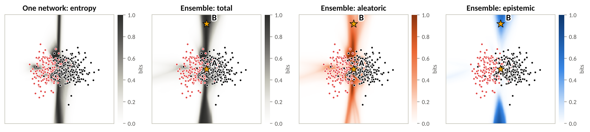
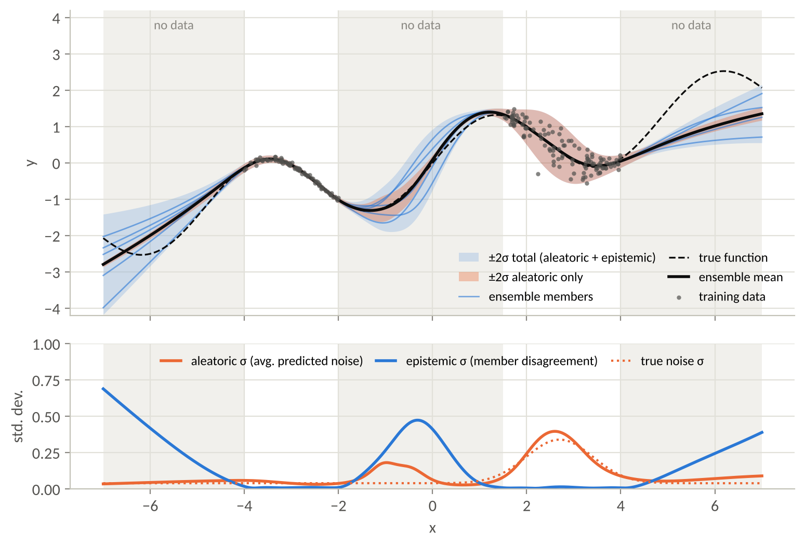
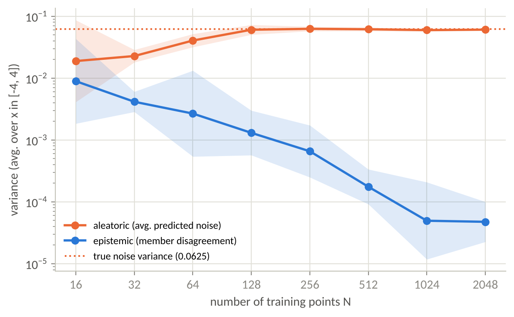
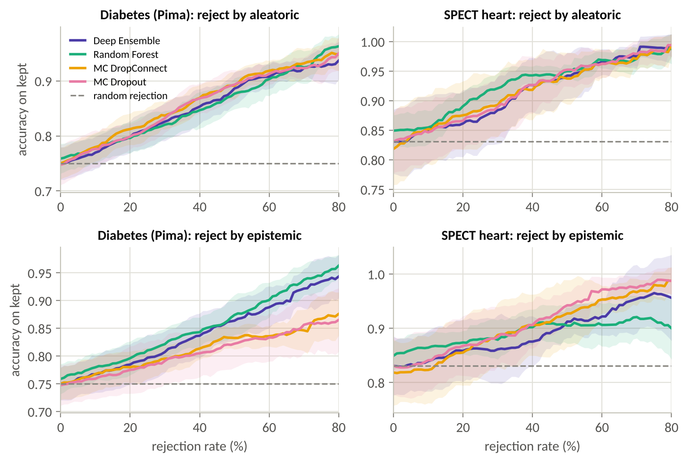
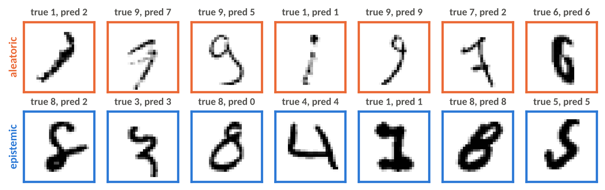
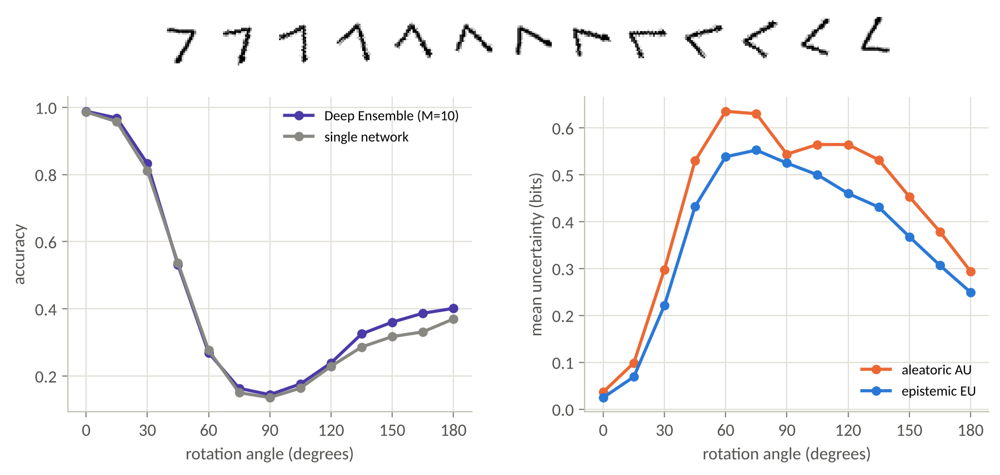

# Uncertainty Modelling: the Ensemble Approach

Group demo for **Advanced Learning Paradigms for AI**, IIT Kharagpur, presented on 12 October 2026.

| Member | Roll number | Part of the talk |
|---|---|---|
| Adusumalli Achyutha Saharsh | 24BT10013 | Why uncertainty: aleatoric vs epistemic; wrap-up |
| Reesh | 24BT10049 | The ensemble approach: building the committee, the decomposition |
| Venkata Sai Praneeth Tadi | 24IM10067 | Evidence from the experiments, live demo |

An ensemble of models is a cheap stand-in for Bayesian model averaging. From the members' predictions we get the
**total** uncertainty of a prediction and split it into an **aleatoric** part (noise in the data, irreducible) and an
**epistemic** part (lack of knowledge, reducible). This is the decomposition from the lecture
(Hüllermeier, slides 27-35; Depeweg et al., 2018):

```
U(x)  = H[ (1/M) * sum_m p(y | x, h_m) ]     total      = entropy of the average
AU(x) = (1/M) * sum_m H[ p(y | x, h_m) ]     aleatoric  = average of the entropies
EU(x) = U(x) - AU(x)                         epistemic  = mutual information I(y; h) = member disagreement
```

For regression the same split is the law of total variance: average predicted variance (aleatoric) plus the variance
of the members' means (epistemic).

## What is in the folder

```
ensemble_uq/            the library
  uncertainty.py        decomposition (classification + regression), the lecture's member table
  ensembles.py          DeepEnsemble, ParallelMLPEnsemble, GaussianEnsemble, MCEnsemble (dropout / DropConnect),
                        LaplaceRandomForest
  models.py             MLP (optional dropout / DropConnect), ParallelMLP, SmallCNN
  metrics.py            accuracy, NLL, Brier, ECE, OOD AUROC, accuracy-rejection curves
  data.py, plotting.py  toy data, tabular data, MNIST loaders; shared figure style
experiments/            E1-E4 (one script each) and run_all.py
app/streamlit_app.py    live demo (2D playground, regression, MNIST vs the unknown) - works offline
notebooks/demo.ipynb    executed walkthrough of all four experiments
checkpoints/            the 10 trained MNIST CNNs + 1 MC-Dropout CNN
results/figures, results/metrics   every figure and number used in the slides
tests/                  checks of the maths (TU = AU + EU, EU = Jensen-Shannon, law of total variance)
```

## Quick start

```bash
python -m venv .venv && source .venv/bin/activate
pip install torch torchvision --index-url https://download.pytorch.org/whl/cpu   # optional: small CPU-only PyTorch
pip install -r requirements.txt

streamlit run app/streamlit_app.py        # live demo, opens in the browser
jupyter notebook notebooks/demo.ipynb     # walkthrough (already executed; re-runs in ~2 min)
python experiments/run_all.py             # regenerate every figure and number (~10 min; --retrain also retrains the CNNs)
python -m pytest -q                       # sanity checks of the maths
```

Run the commands from this folder. MNIST and Fashion-MNIST (~60 MB) download automatically the first time the
notebook or `experiments/e4_mnist_ood.py` needs them; the app does not need them.

## Results

**E1 - 2D toy (two overlapping classes, 10-member deep ensemble).** Query A inside the overlap: U = 0.96,
AU = 0.95, EU = 0.01 bits. Query B far above the data: U = 0.99, AU = 0.48, EU = 0.51 bits.
Same total uncertainty, different cause.

**E2 - regression (5 mean/variance networks).** Epistemic std averages 0.010 where there is data,
0.21 in the gap and 0.29 outside the data. With constant noise
(variance 0.0625) and N = 16 to 2048 training points, the epistemic variance falls 186-fold while the
aleatoric variance settles at 0.061.

**E3 - accuracy-rejection curves (lecture slide 37; 10 random 70/30 splits).** Accuracy on the kept points after rejecting
the 50% most aleatoric-uncertain test points, and the mean accuracy over rejection rates 0-80% ("area"):

| Data | Ensemble | Accuracy, no rejection | Accuracy, 50% rejected (AU) | Area, AU | Area, EU |
|---|---|---|---|---|---|
| Pima diabetes | Deep Ensemble | 75.0% | 88.6% | 0.851 | 0.840 |
| Pima diabetes | Random Forest | 75.9% | 87.7% | 0.851 | 0.852 |
| Pima diabetes | MC DropConnect | 75.0% | 89.1% | 0.862 | 0.811 |
| Pima diabetes | MC Dropout | 74.8% | 89.3% | 0.857 | 0.806 |
| SPECT heart | Deep Ensemble | 83.1% | 94.2% | 0.915 | 0.890 |
| SPECT heart | Random Forest | 84.9% | 95.0% | 0.927 | 0.892 |
| SPECT heart | MC DropConnect | 81.9% | 93.8% | 0.916 | 0.902 |
| SPECT heart | MC Dropout | 83.1% | 95.2% | 0.917 | 0.911 |

**E4 - MNIST, with Fashion-MNIST as never-seen inputs.**

| Model | Accuracy | NLL | Brier | ECE | OOD AUROC (total) | OOD AUROC (EU) |
|---|---|---|---|---|---|---|
| Single network | 98.86% | 0.0388 | 0.0171 | 0.0051 | 0.973 | - |
| Deep Ensemble, M = 5 | 99.27% | 0.0232 | 0.0116 | 0.0044 | - | - |
| Deep Ensemble, M = 10 | 99.28% | 0.0211 | 0.0108 | 0.0040 | 0.988 | 0.985 |
| MC Dropout, 10 passes | 99.04% | 0.0380 | 0.0160 | 0.0156 | 0.981 | 0.961 |

A single network gives 16.2% of Fashion-MNIST images a digit label with more than 99%
confidence. The ankle boot on our first slide is called "3" at 99.4%;
the ten members say 3, 3, 9, 1, 5, 4, 4, 1, 1, 5 (EU = 1.61 bits). Mean epistemic uncertainty is
35x higher on Fashion-MNIST than on MNIST test digits.

| | |
|---|---|
|  |  |
|  |  |
|  |  |

## Live demo (about 2.5 minutes)

Start the app before the talk and keep the browser tab open (first load takes about 10 s).

1. **2D classification.** The star starts at query B (0, 5): the member table shows disagreement, EU about 0.5 bits.
   Drag *query point y* to 0 (query A): EU drops to about 0, AU rises to about 0.95. Set *Members M* = 1: EU is zero everywhere.
2. Set M back to 10 and drag *Training points* from 400 down to 50: the blue (epistemic) regions spread - less data,
   more epistemic uncertainty. Switch the ensemble to *Random Forest* or *MC DropConnect* to compare recipes.
3. **Images.** Drag *rotate* from 0 to 90 degrees: the members start to disagree and EU climbs. Pick *a Fashion-MNIST item*,
   then set *members used* = 1.

If anything goes wrong, open `notebooks/demo.ipynb`: every figure is already rendered there.

## Implementation notes

* `DeepEnsemble` is the plain recipe (a loop over M independently initialised networks, any architecture).
  `ParallelMLPEnsemble` / `GaussianEnsemble` hold M small MLPs as stacked weight tensors and train them together with
  batched matrix products: the same maths, about 1 s for 10 members, which keeps the live demo interactive.
* `LaplaceRandomForest` reads each scikit-learn tree's leaf class counts and predicts (n_k + 1) / (n + K).
* `MCEnsemble` keeps dropout or DropConnect active at prediction time; DropConnect samples one weight mask per pass, so
  every pass is one coherent member.
* All seeds are fixed. The slides read their numbers from `results/metrics/*.json`.

## References

* Hüllermeier, E. (2021). Aleatoric and Epistemic Uncertainty in Machine Learning (course slides).
* Hüllermeier, E. & Waegeman, W. (2021). Aleatoric and epistemic uncertainty in machine learning: an introduction to concepts and methods. *Machine Learning* 110.
* Lakshminarayanan, B., Pritzel, A. & Blundell, C. (2017). Simple and scalable predictive uncertainty estimation using deep ensembles. *NeurIPS*.
* Depeweg, S. et al. (2018). Decomposition of uncertainty in Bayesian deep learning for efficient and risk-sensitive learning. *ICML*.
* Shaker, M. H. & Hüllermeier, E. (2020). Aleatoric and epistemic uncertainty with random forests. *IDA*.
* Gal, Y. & Ghahramani, Z. (2016). Dropout as a Bayesian approximation. *ICML*.
* Mobiny, A. et al. (2021). DropConnect is effective in modeling uncertainty of Bayesian deep networks. *Scientific Reports* 11, 5458.
* Wimmer, L. et al. (2023). Quantifying aleatoric and epistemic uncertainty in machine learning: are conditional entropy and mutual information appropriate measures? *UAI*.
* Data: see `data/README.md`.
